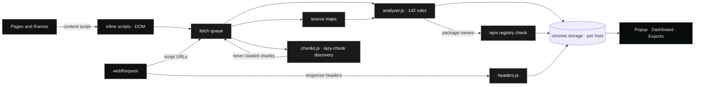

<div align="center">


JS Recon
========

### Passive JavaScript Recon for Bug Bounty & Pentests

**A Chrome / Edge extension that mines every script, inline config, iframe, source map, lazy-loaded chunk and response header of the sites you browse for secrets, API endpoints with their HTTP method, hidden parameters, subdomains, cloud assets and dependency-confusion candidates. Everything runs locally in your browser.**

🎯 [What is it](#-what-is-js-recon) • ✨ [Features](#-features) • 🖥️ [Screenshots](#️-screenshots) • 🏗️ [How it works](#️-how-it-works) • 🚀 [Install](#-install) • 🕹️ [Usage](#️-usage) • ⚙️ [Settings](#️-settings--network-activity) • 🧪 [Tests](#-tests) • 🛡️ [Safety](#️-safety--authorization)

[]()
[](LICENSE)
[]()
[]()
[]()
[]()
[]()
[]()
[]()
[]()
[]()

</div>

---

## 🎯 What is JS Recon

Modern web apps ship their attack surface to the browser: API routes, feature flags, debug switches, internal hostnames, cloud buckets, keys that should never have left the build server, and whole admin screens that are only one lazy chunk away. JS Recon reads all of it **while you browse normally**, and sorts it into something you can act on.

- **Passive first.** It analyses what the browser already loads: scripts, inline `<script>` blocks, iframes and response headers. The default network activity is limited to re-reading those scripts (normally from the cache) and following what the bundle itself points at: source maps and lazy chunks.
- **Sees what the page never loads.** It reads the bundler's chunk list (webpack, Next.js, Vite, ES modules) and scans screens you never opened, admin bundles first.
- **Finds what minifiers hide.** Parameter names read through `l=new URLSearchParams(location.search); l.get(…)`, names declared in config (`initial_message_url_param: "initial-message"`), `data-*` attributes, cookies, storage keys and custom headers.
- **Signal over noise.** Entropy-based confidence on secrets, *interesting* tags on admin / debug / redirect-style names, library noise tagged and hideable.
- **Private.** Findings are stored in `chrome.storage` on your machine and never sent anywhere.

---

## ✨ Features

| Tab | What you get |
|---|---|
| **Secrets** | 68 secret rules: provider-specific keys (AWS, GCP, Azure, GitHub, GitLab, Slack, Stripe, OpenAI, Anthropic, Twilio, SendGrid …), private keys, JWTs (decoded), DB connection strings, credentials in URLs, hard-coded Bearer / Basic auth and a context-based `key = "value"` rule. Each secret gets a **Shannon-entropy confidence**: `certain` / `firm` / `tentative`. |
| **API** | Endpoints **with their HTTP method**, coloured like Swagger UI: `axios.post()`, `http.get<T>()`, `fetch(url, { method })`, `new Request`, `xhr.open("PUT", …)`, `$.ajax({ type, url })`, `axios({ method, url })`, wrapper functions, `` `${base}/path` `` and `BASE + "/path"`. Every row has *curl* and *Copy*. |
| **Endpoints / URLs** | LinkFinder-style extraction with template literals, scheme-less `host.tld/path` strings and Next.js routes. Tagged *interesting* (admin, debug, upload, token, graphql …), *static* or *noise*. |
| **Domains** | Subdomains of the target found anywhere in the code, plus every host from the **Content-Security-Policy** and trusted **CORS** origins. Tagged *same site*, *third party*, *cloud*, *interesting* (dev, staging, internal, jenkins …). |
| **Cloud** | AWS (S3, API Gateway, Lambda URLs, AppSync, RDS, ELB, CloudFront, Cognito, ARNs), Azure, Google Cloud / Firebase, DigitalOcean, Oracle, Alibaba, Rackspace, DreamHost, Cloudflare R2, Wasabi, Backblaze, Linode, IBM COS, Supabase and PaaS hosts. |
| **Params** | Every client-side input, grouped: **query parameters** (also through minified `URLSearchParams` variables, router `query.x`, `getParameterByName()`, `/[?&]token=/` regexes and names declared in config), **`data-*` attributes**, **form fields** (hidden ones tagged), **request headers** (incl. `Access-Control-Allow-Headers`), **cookies** (incl. `Set-Cookie`, session cookies without `HttpOnly` flagged) and **localStorage / sessionStorage keys**. |
| **Deps** | **Dependency confusion**: package names from source maps, `node_modules/…` paths, imports and embedded `package.json` are checked against `registry.npmjs.org`. Missing packages and unclaimed scopes are **critical**. |
| **Intel** | Injected config objects (`window.APP_CONFIG = {…}` with their keys), switched-off **feature flags**, weak CSP (`'unsafe-inline'`, `'unsafe-eval'`, JSONP / user-content hosts), CORS `null` origin and write methods, server / framework **version banners**, platform fingerprints (Cloudflare, CloudFront, Vercel …), unusual custom response headers, lazy-chunk lists, exposed source maps, emails, internal IPs, GraphQL operations, developer comments, postMessage handlers. |
| **Files** | Every scanned source (scripts, lazy chunks, inline scripts, iframes, DOM, source maps, response headers), with size, hits, errors and a **Sources .zip** button that rebuilds the original source tree from a map. |

**Also:** DOM-XSS sink rules (off by default), custom regex rules, a manual scanner for URLs or pasted code, and a **static-file dumper** that zips every JS file, `.map` file and reconstructed source tree of one or more hosts for grep, semgrep or trufflehog.

---

## 🖥️ Screenshots

<table>
  <tr>
    <td width="50%"><br/><sub><b>Secrets</b>: severity-coded, entropy confidence, source location</sub></td>
    <td width="50%"><br/><sub><b>API</b>: endpoints with their HTTP method, Swagger colours, one-click curl</sub></td>
  </tr>
</table>

<p align="center">
  
  <br/><sub><b>Params</b>: every client-side input grouped by kind. Here: the override parameters a chat widget declares in its inline config</sub>
</p>

<table>
  <tr>
    <td width="50%"><br/><sub><b>Domains</b>: subdomains from code, CSP and CORS</sub></td>
    <td width="50%"><br/><sub><b>Intel</b>: exposed source maps, feature flags, headers, internal IPs</sub></td>
  </tr>
</table>

<p align="center">
  
  <br/><sub><b>Files</b>: scripts, never-loaded lazy chunks, iframes, source maps and response headers</sub>
</p>

<table>
  <tr>
    <td width="50%"><br/><sub><b>Settings</b>: scanning, scope, rules and storage</sub></td>
    <td width="50%"><br/><sub><b>Light theme</b>: follows the system setting</sub></td>
  </tr>
</table>

> Black-and-white chrome, colour reserved for meaning: severity, HTTP method, tags. Inter and JetBrains Mono are bundled, so the extension makes no font requests.

---

## 🏗️ How it works



- **Capture.** `webRequest` reports every script the page loads (including chunks loaded later). A content script runs in the page **and its iframes**, collecting inline scripts and, optionally, the rendered DOM. Findings from iframes are filed under the top page's host.
- **Fetch.** A queue re-reads each script with the page's cookies (`force-cache`, so normally from the browser cache) and de-duplicates by SHA-1.
- **Analyse.** `src/analyzer.js` runs the rule set (pure JavaScript, no `chrome.*`, unit-tested in Node). Source maps are followed, including inline `data:` maps. `src/chunks.js` evaluates the bundler's chunk-filename expression for every chunk id. `src/headers.js` reads the target's own response headers.
- **Store and show.** Findings are merged per host into `chrome.storage.local` with every source location and a context snippet. The popup, the full-page dashboard and the exports read from there.

<details>
<summary><b>Lazy-chunk discovery in detail</b></summary>

| Bundler | What is read | Example |
|---|---|---|
| webpack 4 / 5 (CRA, Vue CLI, Angular, Next.js …) | The chunk-filename function, evaluated for every id in its maps, resolved against the public path | `n.u = e => "static/js/" + ({35:"admin"}[e] \|\| e) + "." + {35:"1f2e3d4c"}[e] + ".chunk.js"` |
| Next.js | `static/chunks/…` paths in the runtime, build manifest and app-router flight data; **routes** from `__BUILD_MANIFEST` | `"/admin/users/[id]": ["static/chunks/pages/admin/users/[id]-22bb.js"]` |
| Vite | The preload dependency list | `__vite__mapDeps … m.f = ["assets/Admin-1a2b3c.js", …]` |
| ES modules (esbuild, Rollup, Angular 17+) | Literal dynamic imports | ``import(`./chunk-hAxdiaEY.js`)`` |

Tested against live apps: github.com (1,669 chunks from one runtime), nextjs.org (Turbopack, 56 chunks from the HTML), angular.dev (218 chunks). Up to 400 chunks per host are fetched (configurable), names matching *admin*, *internal*, *billing*, *settings* … first. The full list is in the exports.

</details>

---

## 🚀 Install

1. Clone the repo:
   ```bash
   git clone https://github.com/0xnookie/js-recon.git
   ```
2. Open `chrome://extensions` (or `edge://extensions`) and enable **Developer mode**.
3. Click **Load unpacked** and select the `js-recon` folder.
4. Pin the extension and browse your target. The toolbar badge counts critical findings plus high and medium secrets.

No build step and no runtime dependencies. Chrome / Edge 116+; the styled drop-downs need 135+ and fall back to native ones before that.

---

## 🕹️ Usage

- **Popup:** Secrets · API · Endpoints · URLs · Domains · Cloud · Params · Deps · Intel · Files. Filter with text or `/regex/`, narrow by severity, hide tentative secrets or noise, show only *interesting* items. Click a row for every source location with highlighted context, decoded JWT claims, entropy and npm status.
- **Dashboard** (⤢ in the popup): the same in a full tab, plus a host switcher, the **Manual scan** panel (JS / `.map` URLs or pasted code) and the **Dump** panel.
- **Rescan** re-fetches and re-scans every file of the current host and re-collects the page and its iframes.
- **Export:**

  | Export | Format |
  |---|---|
  | JSON report | one host or all hosts, every finding with its sources, plus the discovered chunk list |
  | Text report | grouped by tab |
  | Endpoints + API as URLs | absolute URLs for ffuf, httpx, nuclei |
  | API endpoints | `METHOD URL` per line |
  | Dump static files | ZIP of JS files, `.map` files and rebuilt source trees |

- **Custom rules** (Settings): one per line as `Name | critical/high/medium/low/info | /regex/flags`; group 1 becomes the value.

---

## ⚙️ Settings & network activity

Everything below runs locally. This is all the traffic the extension itself creates:

| Setting | Default | Traffic |
|---|---|---|
| Passive scanning, inline scripts, page DOM, response headers | on | none beyond re-reading scripts the page loaded (normally from the cache) |
| Follow source maps | on | requests `.map` files the scripts point to |
| **Fetch lazy-loaded chunks** | on, max 400 / host | requests chunk files listed by the bundler runtime |
| Dependency-confusion check | on | sends package **names** to `registry.npmjs.org` (cached 3 days) |
| Guess source-map locations | **off** | requests `file.js.map`, then `file.map` |
| Crawl referenced JS | **off** | requests same-site `.js` URLs found in code |

**Scope:** scan all sites or an allow-list, never scan a deny-list, ignore analytics / ad / consent scripts (editable), optionally first-party scripts only. Iframes follow the same filters as scripts. Every rule can be switched off individually.

---

## 🧪 Tests

```bash
node test/run-tests.mjs        # rules, inputs, headers, lazy chunks, cloud, deps, confidence, ZIP, 6 MB perf check
node test/sw-harness.mjs       # service worker end to end: mocked chrome.*, fetch and npm registry; iframes, chunks, headers, dumper
node test/fp-sweep.mjs <dir>   # scan a directory of real JS and list secret hits (false-positive check)
```

---

## 🗂️ Project layout

```
manifest.json
src/background.js   service worker: capture, fetch queue, source maps, lazy chunks, response headers, npm checks, storage, badge
src/analyzer.js     pure scanning engine (no chrome.*, testable in Node)
src/rules.js        rules, link / API / input classification, dependency extraction, custom-rule parser
src/chunks.js       lazy-chunk discovery (webpack chunk-map evaluator, Next.js, Vite, ESM)
src/headers.js      response-header analysis (CORS, CSP, cookies, banners, custom headers)
src/sourcemap.js    source-map parsing shared by worker and UI
src/zip.js          small ZIP writer (deflate via CompressionStream)
src/content.js      collects script URLs, inline scripts and DOM from pages and iframes
ui/                 popup / dashboard / settings, dump.js (source reconstruction + dumper)
icons/  fonts/      toolbar icons and logo; Inter and JetBrains Mono (SIL OFL)
assets/             README banner and screenshots
test/               Node tests
```

---

## 🗺️ Roadmap

- ✅ **Secrets, API, endpoints, URLs, domains, cloud**: 142 rules, entropy confidence, Swagger-style methods
- ✅ **Source maps**: follow, guess (opt-in), scan original sources, rebuild source trees as ZIP
- ✅ **Dependency confusion**: npm package and scope checks
- ✅ **Inputs**: query parameters, `data-*`, forms, headers, cookies, storage, including config-declared and minified reads
- ✅ **Iframes**: embedded widgets' inline config
- ✅ **Response headers**: CORS, CSP, cookies, banners, custom headers
- ✅ **Lazy chunks**: webpack, Next.js, Vite, ES modules
- ⬜ **Runtime capture (opt-in)**: record the parameter, storage and cookie names the page actually reads, plus its real fetch / XHR calls
- ⬜ **postMessage analysis**: message types per handler and whether the origin is checked
- ⬜ **Wordlist exports** per input kind for ffuf, Arjun and Param Miner
- ⬜ **Historical JS**: old bundles and source maps from the Wayback Machine (opt-in)

---

## 🛡️ Safety & Authorization

JS Recon is for **authorized** security testing only: pentest engagements, bug-bounty programs within their scope, your own systems, CTFs and research.

- ✅ Passive by default; active options (source-map guessing, crawling) are off and labelled
- ✅ Scope allow-list / deny-list and per-rule switches
- ✅ Findings stay in your browser; nothing is uploaded
- ✅ The dependency-confusion check only *reads* the npm registry; nothing is ever published
- ❌ Don't point it at systems you aren't authorized to test
- ❌ Results are leads, not verdicts: confirm secrets, dependency-confusion candidates and CSP / CORS findings before reporting

**Dependency-confusion results need confirming.** A name missing from npm only matters if some build resolves it from the public registry. The scope check uses `/-/org/<scope>/package` and `/-/user/<scope>/package`; if neither answers clearly the result is *scope status unknown*, so check `npmjs.com/org/<scope>` by hand.

---

## 📜 License

MIT, see [`LICENSE`](LICENSE). Bundled fonts: Inter and JetBrains Mono under the SIL Open Font License (`fonts/`).
Use JS Recon only against systems you are explicitly authorized to test.
