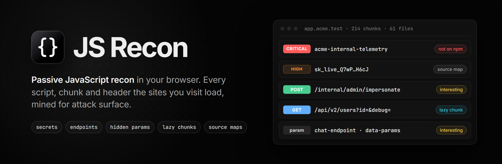
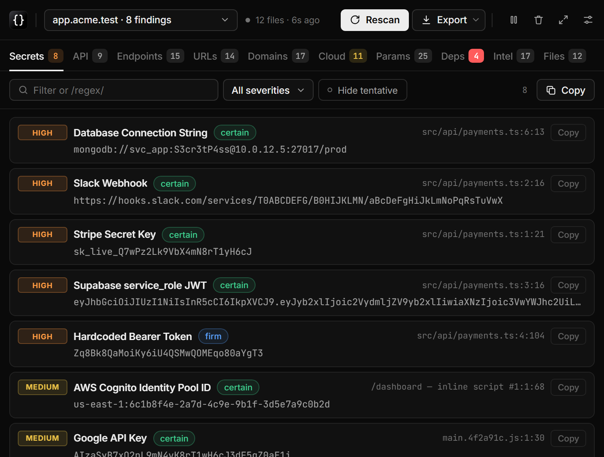
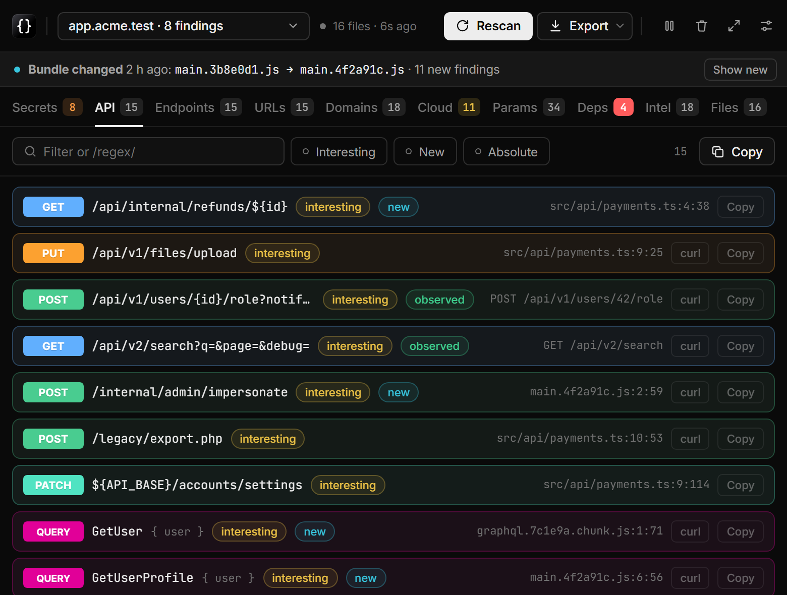
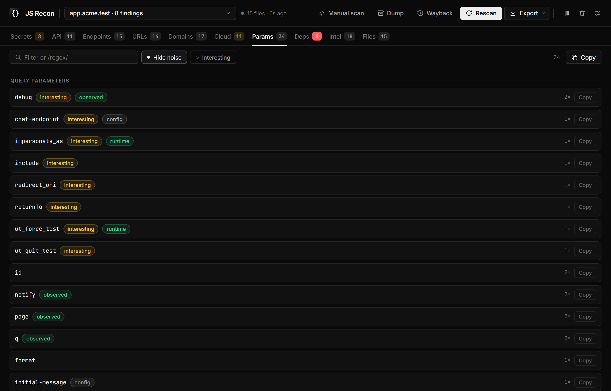
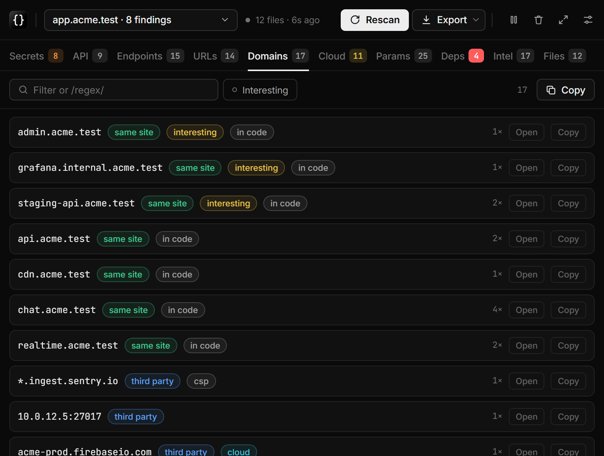
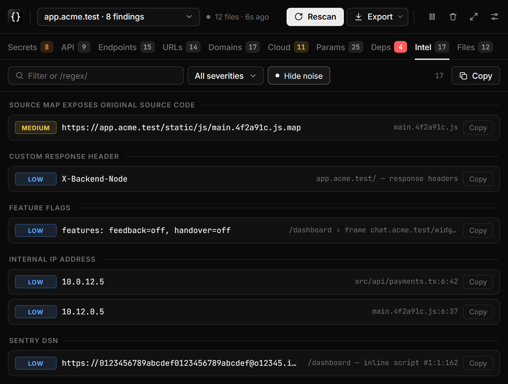
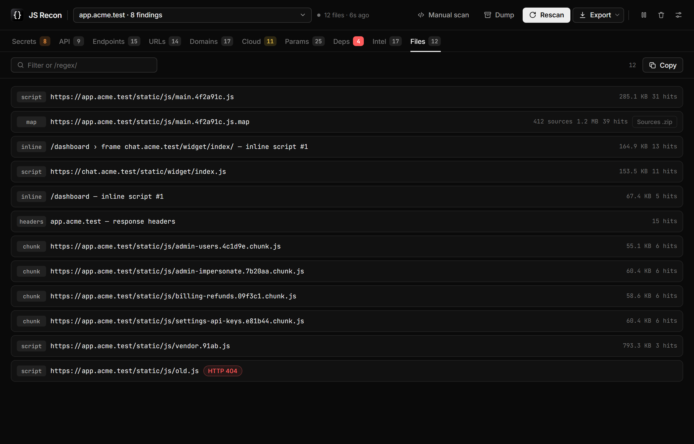
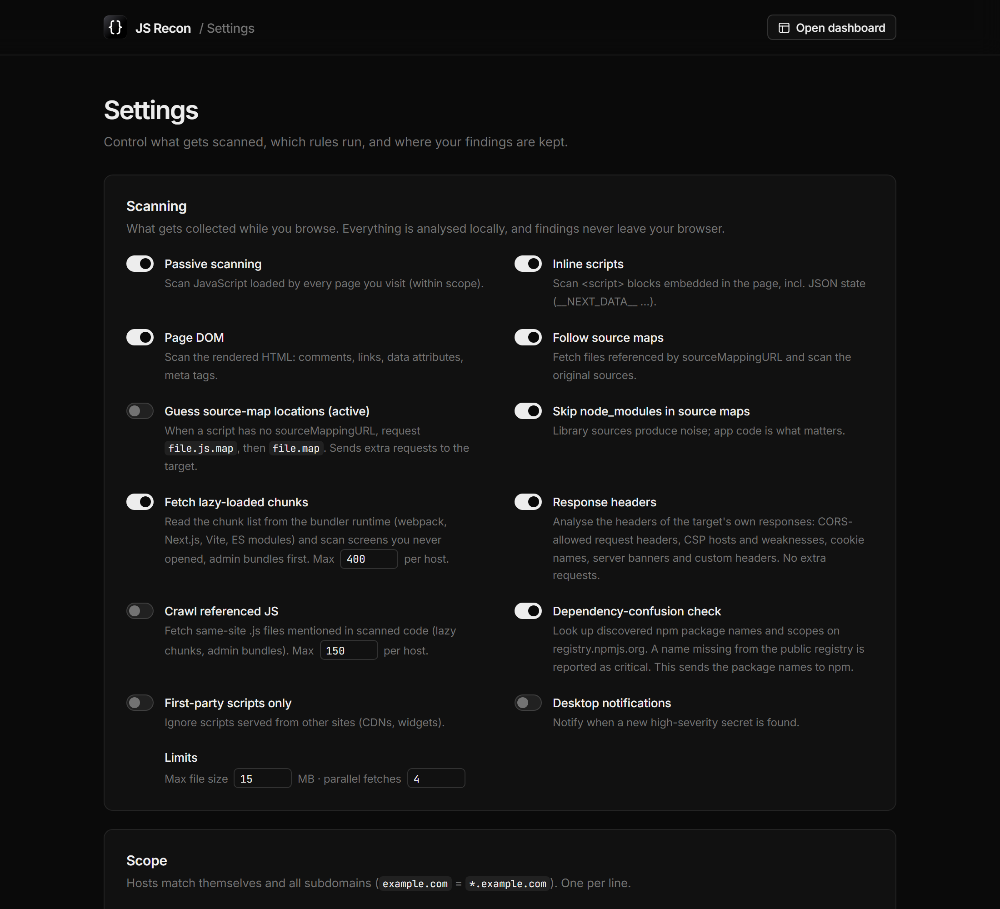
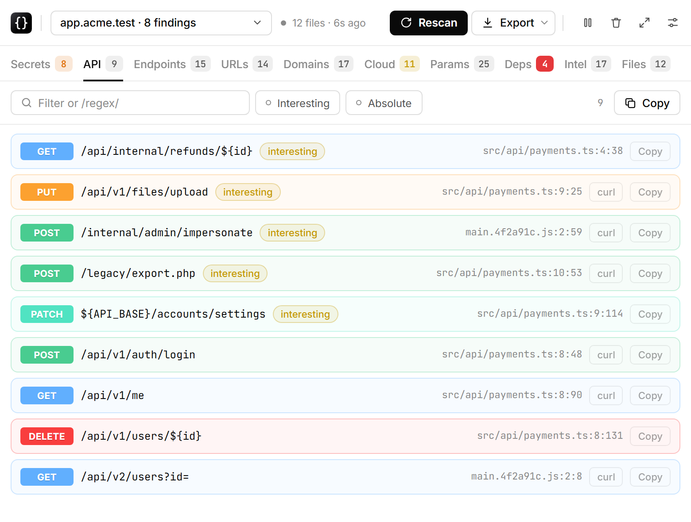
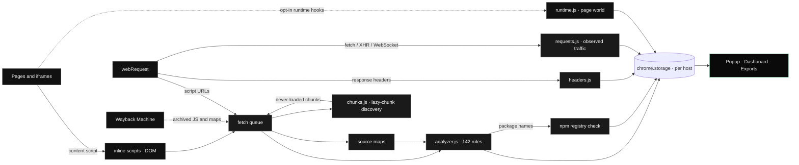

<div align="center">



JS Recon
========

### Passive JavaScript Recon for Bug Bounty & Pentests

**A Chrome / Edge extension that mines every script, inline config, iframe, source map, lazy-loaded chunk, request and response header of the sites you browse, plus their archived JS on the Wayback Machine, for secrets, API endpoints with their HTTP method, GraphQL operations, client-side routes, DOM-XSS taint flows, hidden parameters, postMessage handlers, subdomains, cloud assets and dependency-confusion candidates, and tells you what changed when the app is redeployed. Everything runs locally in your browser.**

🎯 [What is it](#-what-is-js-recon) • ✨ [Features](#-features) • 🖥️ [Screenshots](#️-screenshots) • 🏗️ [How it works](#️-how-it-works) • 🚀 [Install](#-install) • 🕹️ [Usage](#️-usage) • ⚙️ [Settings](#️-settings--network-activity) • 🧪 [Tests](#-tests) • 🛡️ [Safety](#️-safety--authorization)

[](https://github.com/0xnookie/js-recon/actions/workflows/ci.yml)
[]()
[](LICENSE)
[]()
[]()
[]()
[]()
[]()
[]()
[]()
[]()
[]()

</div>

---

## 🎯 What is JS Recon

Modern web apps ship their attack surface to the browser: API routes, feature flags, debug switches, internal hostnames, cloud buckets, keys that should never have left the build server, and whole admin screens that are only one lazy chunk away. JS Recon reads all of it **while you browse normally**, and sorts it into something you can act on.

- **Passive first.** It analyses what the browser already loads: scripts, inline `<script>` blocks, iframes and response headers. The default network activity is limited to re-reading those scripts (normally from the cache) and following what the bundle itself points at: source maps and lazy chunks.
- **Sees what the page never loads.** It reads the bundler's chunk list (webpack, Next.js, Vite, ES modules) and scans screens you never opened, admin bundles first.
- **Finds what minifiers hide.** Parameter names read through `l=new URLSearchParams(location.search); l.get(…)`, names declared in config (`initial_message_url_param: "initial-message"`), `data-*` attributes, cookies, storage keys and custom headers.
- **Confirms it at runtime.** The API calls the page really makes (method, path, parameter and header names) are recorded from the browser's own traffic. Opt-in runtime hooks add the names the code reads at runtime, request body fields and every postMessage handler.
- **Looks back in time.** Old bundles and source maps from the Wayback Machine often still contain endpoints that have since been removed from the live app.
- **Tells you what changed.** When a site is redeployed, the endpoints, parameters and chunks that came with the new version are marked *new*. New code is the least tested code.
- **Hands it to your proxy.** OpenAPI and Postman exports for Burp, Caido, ZAP and Postman, a GraphQL schema sketch, wordlists, and an opt-in "send GET URLs to proxy" that fills the site map.
- **Signal over noise.** Entropy-based confidence on secrets, *interesting* tags on admin / debug / redirect-style names, library noise tagged and hideable.
- **Private.** Findings are stored in `chrome.storage` on your machine and never sent anywhere.

---

## ✨ Features

| Tab | What you get |
|---|---|
| **Secrets** | 76 secret rules: provider-specific keys (AWS, GCP, Azure, GitHub, GitLab, Slack, Stripe, OpenAI, Anthropic, OpenRouter, Perplexity, Twilio, SendGrid, Tailscale, PlanetScale, Databricks, Terraform Cloud, Figma, Sentry …), private keys, JWTs (decoded), DB connection strings, credentials in URLs, hard-coded Bearer / Basic auth and a context-based `key = "value"` rule. Each secret gets a **Shannon-entropy confidence**: `certain` / `firm` / `tentative`. **Offline enrichment, no network:** an AWS access key is decoded to its **owning account number** and key type (long-term vs temporary STS), a GCP service-account JSON and Firebase config reveal their **project**, JWTs are tagged *expired* / *expires-soon* from their `exp` claim, and demo / placeholder values are tagged *example*. One **Hide low-value** toggle drops the *example* and *tentative* noise. |
| **API** | Endpoints **with their HTTP method**, coloured like Swagger UI: `axios.post()`, `http.get<T>()`, `fetch(url, { method })`, `new Request`, `xhr.open("PUT", …)`, `$.ajax({ type, url })`, `axios({ method, url })`, wrapper functions, `` `${base}/path` `` and `BASE + "/path"`. Plus the calls the page **really makes**, tagged *observed*, with IDs normalised (`/users/{id}`). **GraphQL operations** (`gql` templates, Apollo / Relay documents) appear as QUERY / MUTATION / SUBSCRIPTION rows with their variables, root fields and full document. Every row has *curl* and *Copy*. |
| **Endpoints / URLs** | LinkFinder-style extraction with template literals, scheme-less `host.tld/path` strings and Next.js routes. Tagged *interesting* (admin, debug, upload, token, graphql …), *static* or *noise*. |
| **Routes** | The app's own **client-side pages** parsed out of the router config — React Router (`<Route path>`, `createBrowserRouter`), Vue Router and Angular (`loadChildren`, `canActivate`), plus any plain `{ path, component/element }` table. Includes pages that are never linked in the UI (`/admin`, `/internal`, debug consoles). Routes behind an auth / role guard are tagged *guarded*; lazy-loaded modules and redirect targets are captured too. Exported to `routes.txt`. |
| **Domains** | Subdomains of the target found anywhere in the code, plus every host from the **Content-Security-Policy** and trusted **CORS** origins. Tagged *same site*, *third party*, *cloud*, *interesting* (dev, staging, internal, jenkins …). |
| **Cloud** | AWS (S3, API Gateway, Lambda URLs, AppSync, RDS, ELB, CloudFront, Cognito, ARNs), Azure, Google Cloud / Firebase, DigitalOcean, Oracle, Alibaba, Rackspace, DreamHost, Cloudflare R2, Wasabi, Backblaze, Linode, IBM COS, Supabase and PaaS hosts. |
| **Params** | Every client-side input, grouped: **query parameters** (also through minified `URLSearchParams` variables, router `query.x`, `getParameterByName()`, `/[?&]token=/` regexes and names declared in config), **request body fields** (runtime), **`data-*` attributes**, **form fields** (hidden ones tagged), **request headers** (incl. `Access-Control-Allow-Headers` and observed custom headers), **cookies** (incl. `Set-Cookie`, session cookies without `HttpOnly` flagged) and **localStorage / sessionStorage keys**. Names confirmed in real traffic or at runtime are tagged *observed* / *runtime*. |
| **Deps** | **Dependency confusion**: package names from source maps, `node_modules/…` paths, imports and embedded `package.json` are checked against `registry.npmjs.org`. Missing packages and unclaimed scopes are **critical**. |
| **Intel** | Injected config objects (`window.APP_CONFIG = {…}` with their keys), switched-off **feature flags**, weak CSP (`'unsafe-inline'`, `'unsafe-eval'`, JSONP / user-content hosts), CORS `null` origin and write methods, server / framework **version banners**, platform fingerprints (Cloudflare, CloudFront, Vercel …), unusual custom response headers, lazy-chunk lists, exposed source maps, **bundle changes** (redeploys, with what's new), emails, internal IPs, developer comments. **postMessage handlers** with their origin check (none / weak substring / regex / strict), the message types they accept and the sinks the data reaches (HTML, code, navigation, storage, requests, replies to `"*"`). |
| **Sinks** | **DOM-XSS taint flows**, on by default: a URL / attacker-influenced source (`location.hash` / `search` / `href`, `document.URL` / `referrer`, `window.name`, `URLSearchParams`, a query-param getter) reaching a dangerous sink in the same expression — `innerHTML` / `outerHTML`, `insertAdjacentHTML`, `document.write`, `dangerouslySetInnerHTML`, jQuery `.html()`, `eval` / `Function` / string timers (HTML & code sinks, *high*), and `location` / `window.open` navigation, `setAttribute("src"/"srcdoc"/…)` and `srcdoc` (*medium*). Precise enough to run without the noise of raw single-pattern sink rules. |
| **Files** | Every scanned source (scripts, lazy chunks, inline scripts, iframes, DOM, source maps, response headers, observed traffic, runtime hooks, archived files from the Wayback Machine), with size, hits, errors and a **Sources .zip** button that rebuilds the original source tree from a map. |

**Also:**
- **Change alerts**: a banner when the app was redeployed (`main.3b8e0d1.js → main.4f2a91c.js · 11 new findings`), a *new* tag and a **New** filter on every tab, and a desktop notification if enabled. All files that change in one deploy count as one change.
- **GraphQL schema sketch**: types, root fields with argument types, unions / interfaces and input types inferred from the operations and fragments in the client, exported as `.graphql` together with every operation.
- **OpenAPI 3 / Postman v2.1 exports**: methods, path and query parameters, request bodies from the runtime hooks, custom headers, bearer auth and GraphQL operations. For Burp (API scan, or the OpenAPI Parser extension in Community), Caido (ReDocs plugin), ZAP, Postman and Insomnia.
- **Send GET URLs to proxy** (active, two clicks): requests each concrete, harmless-looking same-site GET URL once, so it lands in the site map of the proxy your browser uses.
- **Endpoint liveness** (active, two clicks): sends the same safe same-site GET requests and records the HTTP status next to each endpoint, API and route — telling live (200), **protected (401 / 403, worth testing)**, wrong-method (405), redirecting (3xx) and dead (404) apart. GET only, same site only, capped, never cross-site.
- **Offline secret enrichment** (no network): AWS access keys are decoded to the **account number** that owns them — computed from the key ID locally, nothing is sent to AWS — alongside the key type; GCP service-account JSON and Firebase web config are tied to their **project**; and JWTs are flagged *expired* / *expires-soon* from their `exp` claim. Demo / example-looking values are tagged so they can be hidden. JS Recon never validates a discovered credential against its issuer; confirm a key yourself with the issuer's own tooling (e.g. `aws sts get-access-key-info`).
- **Wordlists** per input kind (params, body fields, headers, cookies, storage keys, paths, path segments, URLs, subdomains), ready for ffuf, Arjun, x8 and Param Miner.
- **Historical JS from the Wayback Machine**: one archived file per distinct script first, sensitive names and source maps first, libraries last.
- A **static-file dumper** that zips every JS file, `.map` file and reconstructed source tree of one or more hosts for grep, semgrep or trufflehog.
- **Content search** that greps the raw text of every scanned JS file and reconstructed source of a host for a string or `/regex/` — the things no detection rule covers: Next.js `ACTION_ID_` server-action refs, feature flags, internal hosts, build constants.
- **Continuous integration**: both test suites, a syntax check of every source and manifest validation run on each push (GitHub Actions); tagged releases are packaged and published automatically.
- Broader single-pattern DOM-XSS sink rules (off by default), custom regex rules and a manual scanner for URLs or pasted code.

---

## 🖥️ Screenshots

<table>
  <tr>
    <td width="50%"><br/><sub><b>Secrets</b>: severity-coded, entropy confidence, source location</sub></td>
    <td width="50%"><br/><sub><b>API</b>: HTTP methods in Swagger colours, GraphQL operations, what's new since the last deploy, one-click curl</sub></td>
  </tr>
</table>

<p align="center">
  
  <br/><sub><b>Params</b>: every client-side input grouped by kind and tagged by where it was seen: in config, in real traffic (<i>observed</i>) or by the runtime hooks</sub>
</p>

<table>
  <tr>
    <td width="50%"><br/><sub><b>Domains</b>: subdomains from code, CSP and CORS</sub></td>
    <td width="50%"><br/><sub><b>Intel</b>: exposed source maps, feature flags, headers, internal IPs</sub></td>
  </tr>
</table>

<p align="center">
  
  <br/><sub><b>Files</b>: scripts, never-loaded lazy chunks, iframes, source maps, headers, observed traffic, runtime hooks and archived files</sub>
</p>

<table>
  <tr>
    <td width="50%"><br/><sub><b>Settings</b>: scanning, scope, rules and storage</sub></td>
    <td width="50%"><br/><sub><b>Light theme</b>: follows the system setting</sub></td>
  </tr>
</table>

> Black-and-white chrome, colour reserved for meaning: severity, HTTP method, tags. Inter and JetBrains Mono are bundled, so the extension makes no font requests.

---

## 🏗️ How it works



- **Capture.** `webRequest` reports every script the page loads (including chunks loaded later), the target's response headers and the fetch / XHR / WebSocket calls the page makes. A content script runs in the page **and its iframes**, collecting inline scripts and, optionally, the rendered DOM. Findings from iframes are filed under the top page's host.
- **Fetch.** A queue re-reads each script with the page's cookies (`force-cache`, so normally from the browser cache) and de-duplicates by SHA-1.
- **Analyse.** `src/analyzer.js` runs the rule set (pure JavaScript, no `chrome.*`, unit-tested in Node). Source maps are followed, including inline `data:` maps. `src/chunks.js` evaluates the bundler's chunk-filename expression for every chunk id. `src/headers.js` reads response headers, `src/requests.js` the requests the page sends.
- **Store and show.** Findings are merged per host into `chrome.storage.local` with every source location and a context snippet. The popup, the full-page dashboard and the exports read from there.

<details>
<summary><b>Runtime hooks (opt-in) in detail</b></summary>

When enabled, `src/runtime.js` is registered with `chrome.scripting.registerContentScripts({ world: "MAIN", runAt: "document_start" })` for in-scope hosts only, and unregistered when you switch it off. It wraps a few native functions in Proxies (same name and `toString`, never throws into the page) and records **names, never values**:

| Hook | Recorded |
|---|---|
| `URLSearchParams.get / getAll / has` | query parameter names the code reads, even when the name is built at runtime |
| `Storage.getItem / setItem / removeItem` | localStorage / sessionStorage keys |
| `document.cookie = …` | names of cookies the code writes |
| `Element.getAttribute / hasAttribute("data-…")` | `data-*` attributes |
| `fetch` / `XMLHttpRequest` bodies | top-level JSON / form field names per endpoint (mass-assignment candidates) |
| `addEventListener("message")` / `onmessage` | the handler's source, analysed for origin check, message types and sinks |

The data reaches the extension through a DOM event, so a page could forge it: runtime findings are tagged *runtime*.

</details>

<details>
<summary><b>Lazy-chunk discovery in detail</b></summary>

| Bundler | What is read | Example |
|---|---|---|
| webpack 4 / 5 (CRA, Vue CLI, Angular, Next.js …) | The chunk-filename function, evaluated for every id in its maps, resolved against the public path | `n.u = e => "static/js/" + ({35:"admin"}[e] \|\| e) + "." + {35:"1f2e3d4c"}[e] + ".chunk.js"` |
| Next.js | `static/chunks/…` paths in the runtime, build manifest and app-router flight data; **routes** from `__BUILD_MANIFEST` | `"/admin/users/[id]": ["static/chunks/pages/admin/users/[id]-22bb.js"]` |
| Vite | The preload dependency list | `__vite__mapDeps … m.f = ["assets/Admin-1a2b3c.js", …]` |
| ES modules (esbuild, Rollup, Angular 17+) | Literal dynamic imports | ``import(`./chunk-hAxdiaEY.js`)`` |

Tested against live apps: github.com (1,669 chunks from one runtime), nextjs.org (Turbopack, 56 chunks from the HTML), angular.dev (218 chunks). Up to 400 chunks per host are fetched (configurable), names matching *admin*, *internal*, *billing*, *settings* … first. The full list is in the exports.

</details>

---

## 🚀 Install

1. Clone the repo:
   ```bash
   git clone https://github.com/0xnookie/js-recon.git
   ```
2. Open `chrome://extensions` (or `edge://extensions`) and enable **Developer mode**.
3. Click **Load unpacked** and select the `js-recon` folder.
4. Pin the extension and browse your target. The toolbar badge counts critical findings plus high and medium secrets.

No build step and no runtime dependencies. Chrome / Edge 116+; the styled drop-downs need 135+ and fall back to native ones before that.

---

## 🕹️ Usage

- **Popup:** Secrets · API · Endpoints · URLs · Domains · Cloud · Params · Deps · Intel · Files. Filter with text or `/regex/`, narrow by severity, hide tentative secrets or noise, show only *interesting* items. Click a row for every source location with highlighted context, decoded JWT claims, entropy and npm status.
- **Dashboard** (⤢ in the popup): the same in a full tab, plus a host switcher, the **Manual scan** panel (JS / `.map` URLs or pasted code), the **Dump** panel, the **Search file contents** panel (grep the chunks for a string or `/regex/`) and **Wayback** (historical JS of the current host).
- **Rescan** re-fetches and re-scans every file of the current host and re-collects the page and its iframes.
- **Export:**

  | Export | Format |
  |---|---|
  | JSON report | one host or all hosts, every finding with its sources, plus the discovered chunk list |
  | Text report | grouped by tab |
  | **Markdown report** | `.md` grouped by tab, ready to paste into a ticket, PR or wiki |
  | **SARIF 2.1.0** | `.sarif` of the secret, sink, intel, cloud and dependency findings with their source file + line, for CI code-scanning (GitHub / GitLab security tabs, DefectDojo, ZAP) |
  | Endpoints + API as URLs | absolute URLs for ffuf, httpx, nuclei |
  | API endpoints | `METHOD URL` per line |
  | **Wordlists** | ZIP: `params.txt`, `query-params.txt`, `body-fields.txt`, `form-fields.txt`, `data-attributes.txt`, `headers.txt`, `cookies.txt`, `storage-keys.txt`, `paths.txt`, `path-segments.txt`, `urls.txt`, `subdomains.txt` and a README with ffuf / Arjun / x8 / Param Miner commands |
  | **GraphQL schema + operations** | `.graphql`: the inferred schema sketch, then every operation and fragment |
  | **OpenAPI 3** | `.json` for Burp (Professional API scan, or the OpenAPI Parser extension in Community), Caido (ReDocs plugin), ZAP, Insomnia |
  | **Postman collection** | v2.1 `.json` for Postman, Insomnia and Caido (ReDocs plugin); `{{baseUrl}}`, `:id` path variables, JSON bodies, a GraphQL folder |
  | Send GET URLs to proxy | not a file: requests each concrete same-site GET URL once (active, see below) |
  | Search file contents | not a file: greps every scanned JS file and rebuilt source of the host for a string or `/regex/` |
  | Dump static files | ZIP of JS files, `.map` files and rebuilt source trees |
  | Historical JS (Wayback) | not a file: fetches and scans archived JS / maps of the host |

- **Custom rules** (Settings): one per line as `Name | critical/high/medium/low/info | /regex/flags`; group 1 becomes the value.

---

## ⚙️ Settings & network activity

Everything below runs locally. This is all the traffic the extension itself creates:

| Setting | Default | Traffic |
|---|---|---|
| Passive scanning, inline scripts, page DOM, response headers, observed requests | on, for sites you approve | none beyond re-reading scripts the page loaded (normally from the cache) |
| Follow source maps | on | requests `.map` files the scripts point to |
| **Fetch lazy-loaded chunks** | on, max 400 / host | requests chunk files listed by the bundler runtime |
| Dependency-confusion check | on | sends package **names** to `registry.npmjs.org` (cached 3 days) |
| Runtime hooks | **off** | none; injects `src/runtime.js` into in-scope pages |
| Wayback Machine for new hosts | **off** (button: on demand) | sends the **host name** to `web.archive.org` and fetches archived files from there, never from the target |
| Guess source-map locations | **off** | requests `file.js.map`, then `file.map` |
| Crawl referenced JS | **off** | requests same-site `.js` URLs found in code |
| Send GET URLs to proxy | manual, two clicks (Export menu) | one GET per concrete same-site URL, max 500, with your cookies; skips URLs with placeholders and anything that sounds state-changing (logout, delete, reset, revoke …); redirects are not followed |

**Scope:** by default JS Recon **asks before scanning a site**. Nothing is fetched, observed or hooked until you OK it: a **?** on the toolbar icon means the tab is waiting, and the popup offers *Scan this tab* (one-off, while the tab stays on that host), *Always scan this site* (adds it to the allow-list) or *Never* (adds it to the deny-list). Other modes: only the active tab, every open tab, or only the allow-list; a deny-list is never scanned in any mode. Analytics / ad / consent scripts are ignored (editable), and scripts can optionally be restricted to first-party only. Iframes follow the same filters as scripts. Every rule can be switched off individually.

---

## 🧪 Tests

```bash
node test/run-tests.mjs        # rules, inputs, headers, lazy chunks, postMessage, routes, DOM-XSS taint, offline enrichment
                               # (AWS/GCP/Firebase + JWT expiry), provider-token rules, observed requests, GraphQL + schema,
                               # OpenAPI / Postman / SARIF, Wayback order, ZIP, 6 MB perf check
node test/sw-harness.mjs       # service worker end to end with mocked chrome.*, fetch, npm and archive.org: iframes, chunks,
                               # headers, observed traffic, runtime hooks, Wayback, change alerts, send to proxy, endpoint liveness, dumper
node test/fp-sweep.mjs <dir>   # scan a directory of real JS and list secret hits (false-positive check)
```

---

## 🗂️ Project layout

```
manifest.json
src/background.js   service worker: capture, fetch queue, source maps, lazy chunks, headers, traffic, runtime, Wayback, npm, storage
src/analyzer.js     pure scanning engine (no chrome.*, testable in Node)
src/rules.js        rules, link / API / input classification, postMessage analysis, dependency extraction, custom rules
src/chunks.js       lazy-chunk discovery (webpack chunk-map evaluator, Next.js, Vite, ESM)
src/routes.js       client-side route-map extraction (React Router, Vue Router, Angular)
src/taint.js        DOM-XSS taint flows (source → sink in one expression)
src/enrich.js       offline secret enrichment (AWS key → account number, GCP/Firebase → project, JWT expiry, example / demo triage)
src/headers.js      response-header analysis (CORS, CSP, cookies, banners, custom headers)
src/requests.js     observed requests (path normalisation, parameter / header names), script families, Wayback order
src/graphql.js      GraphQL document extraction, parser and schema sketch
src/exporters.js    OpenAPI 3 and Postman v2.1 builders, "send to proxy" URL filter
src/runtime.js      opt-in hooks that run in the page's own world
src/sourcemap.js    source-map parsing shared by worker and UI
src/zip.js          small ZIP writer (deflate via CompressionStream)
src/content.js      collects script URLs, inline scripts and DOM from pages and iframes
ui/                 popup / dashboard / settings, dump.js (source reconstruction + dumper), search.js (content grep)
icons/  fonts/      toolbar icons and logo; Inter and JetBrains Mono (SIL OFL)
assets/             README banner and screenshots
test/               Node tests
.github/workflows/  CI (tests + checks) and tagged-release packaging
```

---

## 🛡️ Safety & Authorization

JS Recon is for **authorized** security testing only: pentest engagements, bug-bounty programs within their scope, your own systems, CTFs and research.

- ✅ Passive by default; active options (source-map guessing, crawling) are off and labelled
- ✅ Runtime hooks and automatic Wayback lookups are opt-in; hooks only run on in-scope hosts
- ✅ "Send GET URLs to proxy" needs two clicks, stays on the target's own site and skips anything that sounds state-changing
- ✅ Only names are recorded from real traffic and at runtime, never values (Authorization: scheme only)
- ✅ Scope allow-list / deny-list and per-rule switches
- ✅ Findings stay in your browser; nothing is uploaded
- ✅ The dependency-confusion check only *reads* the npm registry; nothing is ever published
- ❌ Don't point it at systems you aren't authorized to test
- ❌ Results are leads, not verdicts: confirm secrets, dependency-confusion candidates and CSP / CORS findings before reporting

**Dependency-confusion results need confirming.** A name missing from npm only matters if some build resolves it from the public registry. The scope check uses `/-/org/<scope>/package` and `/-/user/<scope>/package`; if neither answers clearly the result is *scope status unknown*, so check `npmjs.com/org/<scope>` by hand.

---

## 📜 License

MIT, see [`LICENSE`](LICENSE). Bundled fonts: Inter and JetBrains Mono under the SIL Open Font License (`fonts/`).
Use JS Recon only against systems you are explicitly authorized to test.
