<div align="center">

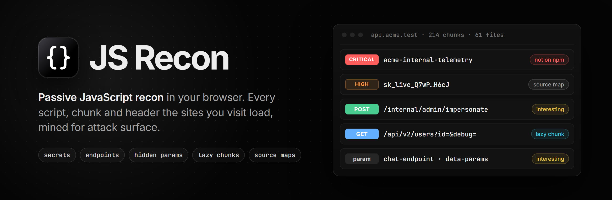

JS Recon
========

### Passive JavaScript Recon for Bug Bounty & Pentests

**A Chrome / Edge extension that mines every script, inline config, iframe, source map, lazy-loaded chunk, request and response header of the sites you browse, plus their archived JS on the Wayback Machine, for secrets, API endpoints with their HTTP method, GraphQL operations, client-side routes, DOM-XSS taint flows, hidden parameters, postMessage handlers, subdomains (with which are live and which are high-value targets), cloud assets and dependency-confusion candidates, and tells you what changed when the app is redeployed. Everything runs locally in your browser.**

🎯 [What is it](#-what-is-js-recon) • ✨ [Features](#-features) • 🖥️ [Screenshots](#️-screenshots) • 🏗️ [How it works](#️-how-it-works) • 🚀 [Install](#-install) • 🕹️ [Usage](#️-usage) • ⚙️ [Settings](#️-settings--network-activity) • 🧪 [Tests](#-tests) • 🛡️ [Safety](#️-safety--authorization)

[](https://github.com/0xnookie/js-recon/actions/workflows/ci.yml)
[]()
[](LICENSE)
[]()
[]()
[]()
[]()
[]()
[]()
[]()
[]()
[]()

</div>

---

## 🎯 What is JS Recon

Modern web apps ship their attack surface to the browser: API routes, feature flags, debug switches, internal hostnames, cloud buckets, keys that should never have left the build server, and whole admin screens that are only one lazy chunk away. JS Recon reads all of it **while you browse normally**, and sorts it into something you can act on.

- **Passive first.** It analyses what the browser already loads: scripts, inline `<script>` blocks, iframes and response headers. The default network activity is limited to re-reading those scripts (normally from the cache) and following what the bundle itself points at: source maps and lazy chunks.
- **Sees what the page never loads.** It reads the bundler's chunk list (webpack, Next.js, Vite, ES modules) and scans screens you never opened, admin bundles first.
- **Reads the feature flags.** Flag keys the app asks LaunchDarkly, GrowthBook, Unleash, Optimizely, Flagsmith, Statsig, Split, ConfigCat or PostHog about, and which of them are switched off for you: the unreleased features that often already work on the server.
- **Finds what minifiers hide.** Parameter names read through `l=new URLSearchParams(location.search); l.get(…)`, names declared in config (`initial_message_url_param: "initial-message"`), `data-*` attributes, cookies, storage keys and custom headers.
- **Confirms it at runtime.** The API calls the page really makes (method, path, parameter and header names) are recorded from the browser's own traffic. Opt-in runtime hooks add the names the code reads at runtime, request body fields and every postMessage handler.
- **Looks back in time.** Old bundles and source maps from the Wayback Machine often still contain endpoints that have since been removed from the live app.
- **Maps the target's hosts.** Subdomains from the code, headers, the page's own traffic and certificate-transparency logs, which of them are **live**, and which are **high-value targets** (CI/CD, admin panels, staging, VPN, exposed dashboards, possible subdomain takeovers), each with the reason.
- **Tells you what changed.** When a site is redeployed, the endpoints, parameters and chunks that came with the new version are marked *new*. New code is the least tested code.
- **Remembers what you've looked at.** Mark rows *reviewed*, *reported* or *false positive*; the status survives rescans and redeploys, and **To review** shows only what's left.
- **Knows the program's scope.** Paste the scope from HackerOne, Bugcrowd, Intigriti or YesWeHack (or HackerOne's CSV / Burp's JSON): active checks only go to what it lists, out-of-scope hosts are greyed, and one view merges every in-scope host.
- **Hands it to your proxy.** OpenAPI and Postman exports for Burp, Caido, ZAP and Postman, a GraphQL schema sketch, wordlists, and an opt-in "send GET URLs to proxy" that fills the site map.
- **Signal over noise.** Entropy-based confidence on secrets, *interesting* tags on admin / debug / redirect-style names, library noise tagged and hideable.
- **Private.** Findings are stored in `chrome.storage` on your machine and never sent anywhere.
- **Chrome, Edge, Firefox and the command line.** The same engine runs as a browser extension and as `js-recon` in a terminal, for scripted pipelines and CI.

---

## ✨ Features

| Tab | What you get |
|---|---|
| **Secrets** | 82 secret rules: provider-specific keys (AWS, GCP, Azure, GitHub, GitLab, Slack, Stripe, OpenAI, Anthropic, OpenRouter, Perplexity, Twilio, SendGrid, Tailscale, PlanetScale, Databricks, Terraform Cloud, Figma, Sentry, server-side LaunchDarkly / Statsig / Flagsmith keys …), private keys, JWTs (decoded), DB connection strings, credentials in URLs, hard-coded Bearer / Basic auth and a context-based `key = "value"` rule. **Passwords** beyond that rule: a username next to a short password (`{ username: "admin", password: "admin123" }`, `auth: { user, pass }`) is reported as **credentials**, client-side checks (`if (pass.value === "letmein")`), short keys (`pass`, `pw`, `passphrase`, `DB_PASS`), values behind a variable (`const p = "…"; login({ password: p })`) or `atob("…")`, `btoa("user:pass")` Basic auth and password inputs shipped with a value. Labels, i18n keys, autocomplete values and placeholders are skipped. Each secret gets a **Shannon-entropy confidence**: `certain` / `firm` / `tentative`. **Offline enrichment, no network:** an AWS access key is decoded to its **owning account number** and key type (long-term vs temporary STS), a GCP service-account JSON and Firebase config reveal their **project**, JWTs are tagged *expired* / *expires-soon* from their `exp` claim, and demo / placeholder values are tagged *example*. One **Hide low-value** toggle drops the *example* and *tentative* noise. |
| **API** | Endpoints **with their HTTP method**, coloured like Swagger UI: `axios.post()`, `http.get<T>()`, `fetch(url, { method })`, `new Request`, `xhr.open("PUT", …)`, `$.ajax({ type, url })`, `axios({ method, url })`, wrapper functions, `` `${base}/path` `` and `BASE + "/path"`, also when the **URL is held in a variable** (`let url = "action.php"; xhr.open("POST", url)`) and for bare server scripts (`action.php`, `Save.aspx`, `login.do`). **Request bodies are read from the code**: `JSON.stringify({…})`, object literals, `FormData.append()`, `URLSearchParams`, `"a=1&b=" + x` strings, `xhr.send(data)`, `fetch(…, { body })`, `axios.post(url, data)`, `$.post` / `$.ajax({ data })`, `ky({ json })` (and variables holding them), so a row reads `POST action.php { id }` and *curl* sends the real payload (`--data-raw '{"id":1}'`, form-encoded or multipart as the page does). axios `params` and `$.get` data become query parameters. Rows that send an object ID (`id`, `userId`, `order_id`, `/users/{id}`, `"/tokens/" + id`) are tagged ***idor***, and the tab is **sorted by what to test first**: sensitive names, IDOR candidates, state-changing methods, known inputs. Plus the calls the page **really makes**, tagged *observed*, with IDs normalised (`/users/{id}`). **GraphQL operations** (`gql` templates, Apollo / Relay documents) appear as QUERY / MUTATION / SUBSCRIPTION rows with their variables, root fields and full document. Every row has *curl* and *Copy*. |
| **Endpoints / URLs** | LinkFinder-style extraction with template literals, scheme-less `host.tld/path` strings and Next.js routes. Tagged *interesting* (admin, debug, upload, token, graphql …), *static* or *noise*. |
| **Routes** | The app's own **client-side pages** parsed out of the router config — React Router (`<Route path>`, `createBrowserRouter`), Vue Router and Angular (`loadChildren`, `canActivate`), plus any plain `{ path, component/element }` table. Includes pages that are never linked in the UI (`/admin`, `/internal`, debug consoles). Routes behind an auth / role guard are tagged *guarded*; lazy-loaded modules and redirect targets are captured too. Exported to `routes.txt`. |
| **Flags** | **Feature flags** the code evaluates, from the SDK calls — `ld.variation("new-checkout", false)`, `useFeatureIsOn("x")`, `unleash.isEnabled("x")`, `useDecision("x")`, `flagsmith.hasFeature("x")`, `statsig.checkGate("x")`, `getTreatment("x")`, `getValueAsync("x")`, `posthog.isFeatureEnabled("x")`, in-house `isFeatureEnabled("x")`, also minified as `(0,o.useFeatureIsOn)("x")` — with the **default** the code falls back to, and their **state** from bootstrap / config payloads in the bundle or page (LaunchDarkly flag state, GrowthBook features, Unleash toggles, Flagsmith flags, Optimizely datafiles, `features: { x: false }` objects). Flags that are **off** for this page come first, names like *admin*, *beta*, *internal*, *v2* are tagged *interesting*. Generic method names only count next to their SDK. The client-side ID of the flag service goes to Intel; a server-side SDK key is a **secret**. Tab shown once a flag is found. |
| **Domains** | Subdomains of the target found anywhere in the code, every host from the **Content-Security-Policy** and trusted **CORS** origins, the hosts the page **really loads from** (*observed*, live by definition) and, on request, every name in the **certificate-transparency logs** (crt.sh, *ct*). **Check live** (two clicks) sends one `GET /` to each subdomain and shows its status, page title, server and final URL after redirects; a made-up name is checked too, so **wildcard DNS** is spotted and its fake hits are discounted. Each host is rated as a **high-value target** (*high* / *medium*, sorted first) from what its name says — CI/CD, admin / internal, staging / dev, monitoring, data stores, VPN / mail, origin (CDN bypass), SSO — and what it answered: Jenkins, Grafana, Kibana, phpMyAdmin, an open Elasticsearch, a directory listing, a debug page, 401 / 403, a redirect to corporate SSO, or a **subdomain-takeover** signature (S3, GitHub Pages, Heroku, Shopify and 22 more). Every rating says why. A **Live** filter shows just the hosts that answered. |
| **Cloud** | AWS (S3, API Gateway, Lambda URLs, AppSync, RDS, ELB, CloudFront, Cognito, ARNs), Azure, Google Cloud / Firebase, DigitalOcean, Oracle, Alibaba, Rackspace, DreamHost, Cloudflare R2, Wasabi, Backblaze, Linode, IBM COS, Supabase and PaaS hosts. |
| **Params** | Every client-side input, grouped: **query parameters** (also through minified `URLSearchParams` variables, router `query.x`, `getParameterByName()`, `/[?&]token=/` regexes and names declared in config), **request body fields** (from the request code and the runtime hooks, each linked to its endpoints, object IDs tagged *idor*), **`data-*` attributes**, **form fields** (hidden ones tagged), **request headers** (incl. `Access-Control-Allow-Headers` and observed custom headers), **cookies** (incl. `Set-Cookie`, session cookies without `HttpOnly` flagged) and **localStorage / sessionStorage keys**. Names confirmed in real traffic or at runtime are tagged *observed* / *runtime*. |
| **Deps** | **Dependency confusion**: package names from source maps, `node_modules/…` paths, imports and embedded `package.json` are checked against `registry.npmjs.org`. Missing packages and unclaimed scopes are **critical**. **Known-vulnerable libraries**: versions of jQuery, AngularJS, DOMPurify, lodash, Bootstrap, Vue, Handlebars, Next.js and 60 more are read from banners, version strings, script URLs / file names, `node_modules` sources in source maps and the bundle's `.LICENSE.txt` (where webpack moves the banners), then matched **offline** against the bundled [retire.js](https://github.com/RetireJS/retire.js) advisory list: each row shows the advisories (CVE / GHSA, summary, affected range, link), the version that fixes them all, or *end of life*. |
| **Intel** | Injected config objects (`window.APP_CONFIG = {…}` with their keys), switched-off **feature flags**, weak CSP (`'unsafe-inline'`, `'unsafe-eval'`, JSONP / user-content hosts), CORS `null` origin and write methods, server / framework **version banners**, platform fingerprints (Cloudflare, CloudFront, Vercel …), unusual custom response headers, lazy-chunk lists, exposed source maps, **bundle changes** (redeploys, with what's new), emails, internal IPs, developer comments. **postMessage handlers** with their origin check (none / weak substring / regex / strict), the message types they accept and the sinks the data reaches (HTML, code, navigation, storage, requests, replies to `"*"`). |
| **Sinks** | **DOM-XSS taint flows**, on by default: a URL / attacker-influenced source (`location.hash` / `search` / `href`, `document.URL` / `referrer`, `window.name`, `URLSearchParams`, a query-param getter) reaching a dangerous sink in the same expression — `innerHTML` / `outerHTML`, `insertAdjacentHTML`, `document.write`, `dangerouslySetInnerHTML`, jQuery `.html()`, `eval` / `Function` / string timers (HTML & code sinks, *high*), and `location` / `window.open` navigation, `setAttribute("src"/"srcdoc"/…)` and `srcdoc` (*medium*). Precise enough to run without the noise of raw single-pattern sink rules. |
| **Files** | Every scanned source (scripts, lazy chunks, inline scripts, iframes, DOM, source maps, response headers, observed traffic, runtime hooks, archived files from the Wayback Machine), with size, hits, errors and a **Sources .zip** button that rebuilds the original source tree from a map. |

**Also:**
- **Change alerts**: a banner when the app was redeployed (`main.3b8e0d1.js → main.4f2a91c.js · 11 new findings`), a *new* tag and a **New** filter on every tab, and a desktop notification if enabled. All files that change in one deploy count as one change.
- **GraphQL schema sketch**: types, root fields with argument types, unions / interfaces and input types inferred from the operations and fragments in the client, exported as `.graphql` together with every operation.
- **OpenAPI 3 / Postman v2.1 exports**: methods, path and query parameters, request bodies with example values and the page's encoding (JSON, form, multipart) from the request code and the runtime hooks, custom headers, bearer auth and GraphQL operations. For Burp (API scan, or the OpenAPI Parser extension in Community), Caido (ReDocs plugin), ZAP, Postman and Insomnia.
- **Send GET URLs to proxy** (active, two clicks): requests each concrete, harmless-looking same-site GET URL once, so it lands in the site map of the proxy your browser uses.
- **Subdomain liveness and high-value targets** (Domains tab): *Find more (crt.sh)* adds every name from the certificate-transparency logs (sends the domain name to crt.sh, nothing to the target); *Check live* (active, two clicks) requests `/` of each subdomain over HTTPS, then HTTP, without cookies — max 500 hosts, same registrable domain only, deny-listed hosts never — and rates each one. Exported as `live-hosts.txt` and `high-value-hosts.txt` and at the top of the text / Markdown reports.
- **Endpoint liveness** (active, two clicks): sends the same safe same-site GET requests and records the HTTP status next to each endpoint, API and route — telling live (200), **protected (401 / 403, worth testing)**, wrong-method (405), redirecting (3xx) and dead (404) apart. GET only, same site only, capped, never cross-site.
- **Triage**: every row has a ✓ (*reviewed*) button, and its detail offers *Reviewed* / *Reported* / *False positive* and a **note** ("reported as H1 #123456", shown on the row, searchable, in the reports). The **Status** filter shows everything, only what's left **to review** (tab counts follow), or one status; **Mark reviewed** (a ✓ icon next to Copy in the popup) marks every row shown (two clicks). Triaged secrets stop counting on the toolbar badge and in notifications; false positives are left out of the text / Markdown reports and SARIF. Kept per host, apart from the findings, so rescans and redeploys keep it.
- **Program scope** (Settings → *Program scope*): paste the scope table of a HackerOne / Bugcrowd / Intigriti / YesWeHack program (the *In scope* / *Out of scope* headings are understood), HackerOne's scope CSV or Burp's project-options JSON. `*.acme.com` (every subdomain), `acme.com` (that host), `api-*.acme.com`, `app.acme.com:8443`, `https://acme.com/api` (paths count for URL checks) and IPv4 ranges; out of scope wins, unlisted counts as out. Once set, the subdomain live check, endpoint liveness, *Send GET URLs to proxy* and source-map guessing **only contact in-scope hosts and URLs**. A host that isn't in scope shows a chip next to the host menu (in scope: a green status dot), the Domains tab greys out-of-scope hosts and gets an **In scope** filter, the ask-first prompt says whether the site is in scope, and *Scan in-scope sites without asking* can stand in for the per-site OK.
- **All in-scope hosts** (host menu, with a scope set): every scanned in-scope host merged into one view and one set of exports. Relative endpoints and API paths are made absolute per host so they stay apart; a secret found on several hosts is one row listing them all. Triage from here is written back to every host. *Check live* and *Find more (crt.sh)* run across every in-scope site at once.
- **Offline secret enrichment** (no network): AWS access keys are decoded to the **account number** that owns them — computed from the key ID locally, nothing is sent to AWS — alongside the key type; GCP service-account JSON and Firebase web config are tied to their **project**; and JWTs are flagged *expired* / *expires-soon* from their `exp` claim. Demo / example-looking values are tagged so they can be hidden. JS Recon never validates a discovered credential against its issuer; confirm a key yourself with the issuer's own tooling (e.g. `aws sts get-access-key-info`).
- **Fresh advisory data**: every tagged release downloads the latest retire.js advisories before it runs the tests and packages the extension.
- **Wordlists** per input kind (params, body fields, headers, cookies, storage keys, paths, path segments, URLs, subdomains, live hosts, high-value hosts), ready for ffuf, Arjun, x8, Param Miner, httpx and nuclei.
- **Historical JS from the Wayback Machine**: one archived file per distinct script first, sensitive names and source maps first, libraries last.
- A **static-file dumper** that zips every JS file, `.map` file and reconstructed source tree of one or more hosts for grep, semgrep or trufflehog.
- **Content search** that greps the raw text of every scanned JS file and reconstructed source of a host for a string or `/regex/` — the things no detection rule covers: Next.js `ACTION_ID_` server-action refs, feature flags, internal hosts, build constants.
- **Continuous integration**: both test suites, a syntax check of every source and manifest validation run on each push (GitHub Actions); tagged releases are packaged and published automatically.
- Broader single-pattern DOM-XSS sink rules (off by default), custom regex rules and a manual scanner for URLs or pasted code.

---

## 🖥️ Screenshots

<table>
  <tr>
    <td width="50%">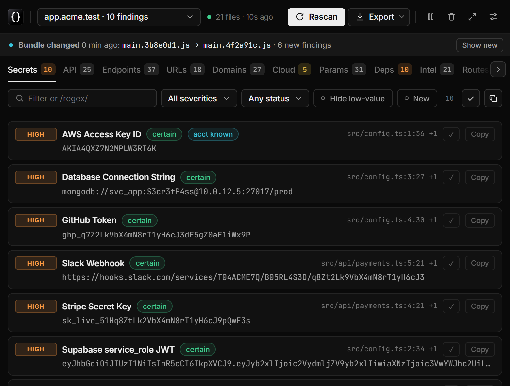<br/><sub><b>Secrets</b>: severity-coded, entropy confidence, located in the original source when a source map is exposed</sub></td>
    <td width="50%">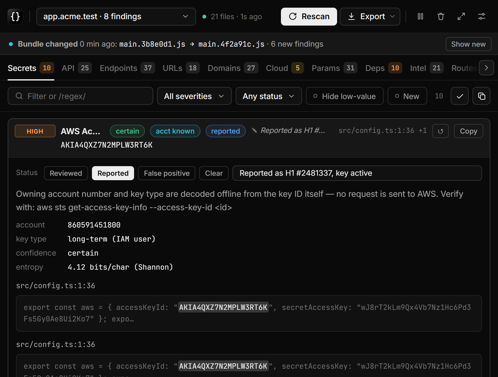<br/><sub><b>Triage</b>: <i>reviewed</i> / <i>reported</i> / <i>false positive</i> and a note per row; the AWS key is decoded to its owning account, offline</sub></td>
  </tr>
</table>

<p align="center">
  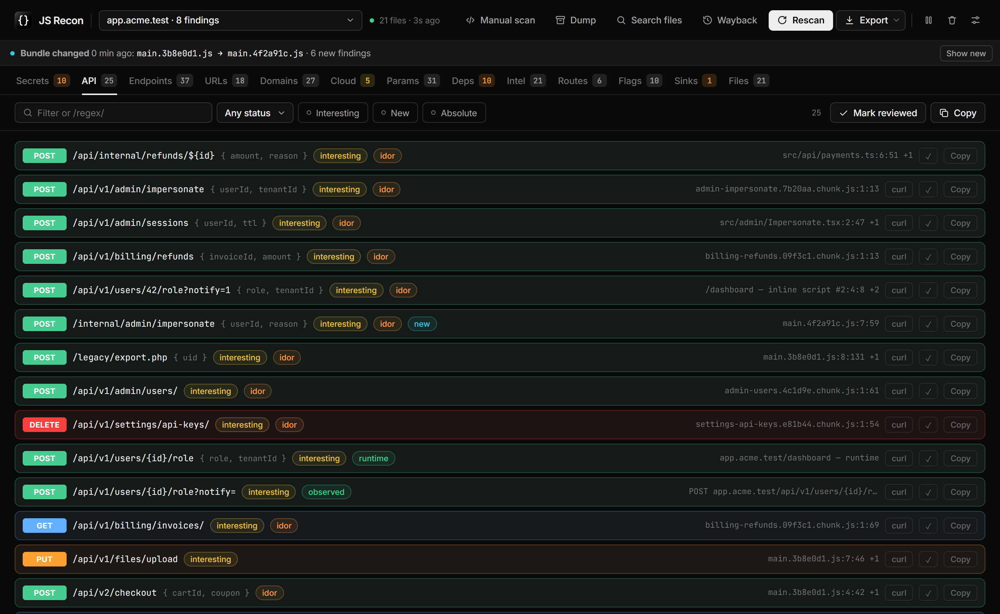
  <br/><sub><b>API</b>: HTTP methods in Swagger colours, request body fields, IDOR candidates, GraphQL operations, what's <i>new</i> since the last deploy, one-click curl</sub>
</p>

<table>
  <tr>
    <td width="50%">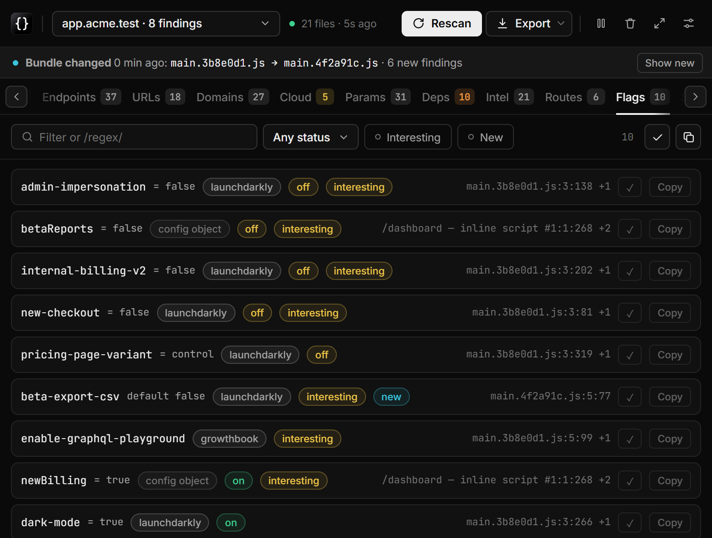<br/><sub><b>Flags</b>: the feature flags the code evaluates (LaunchDarkly, GrowthBook, config objects …) and their state for this page, switched-off ones first</sub></td>
    <td width="50%">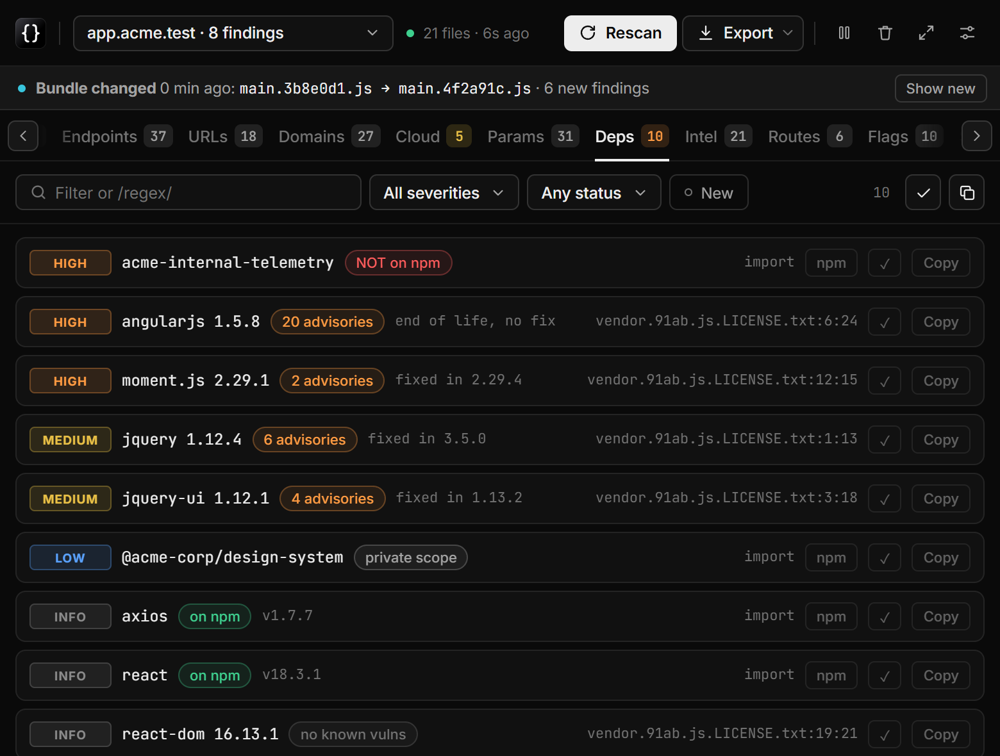<br/><sub><b>Deps</b>: package names missing from npm (dependency confusion) and bundled library versions with known advisories</sub></td>
  </tr>
</table>

<p align="center">
  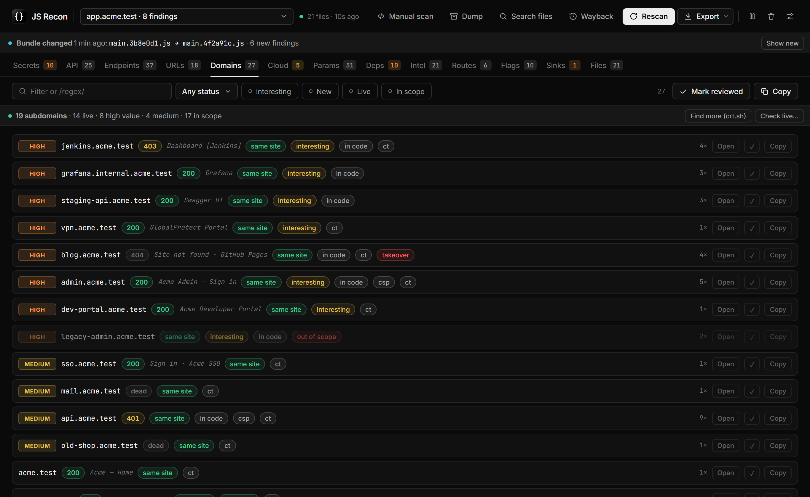
  <br/><sub><b>Domains</b>: subdomains from the code, CSP, the page's traffic and certificate transparency (crt.sh); the two-click live check adds status and page title, high-value targets come first, takeover signatures are flagged and out-of-scope hosts greyed</sub>
</p>

<table>
  <tr>
    <td width="50%">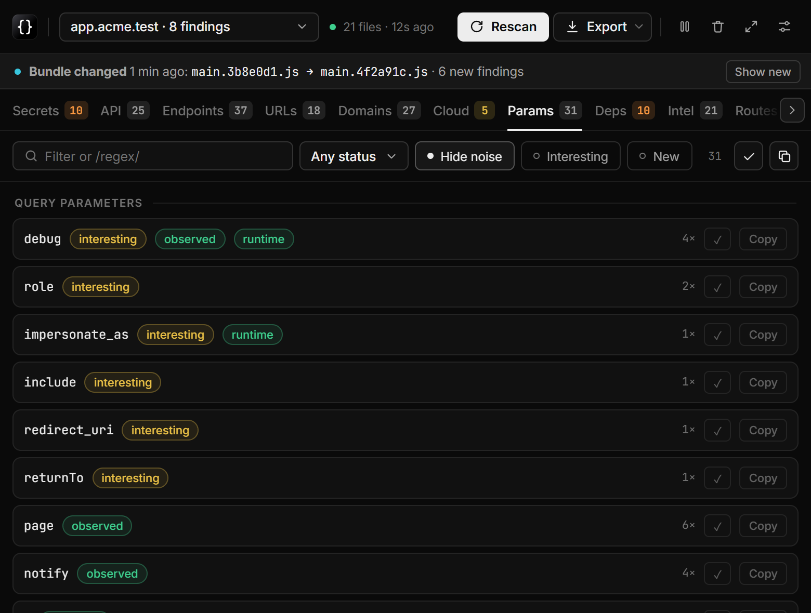<br/><sub><b>Params</b>: every client-side input, tagged by where it was seen: in the code, in real traffic (<i>observed</i>) or by the runtime hooks</sub></td>
    <td width="50%">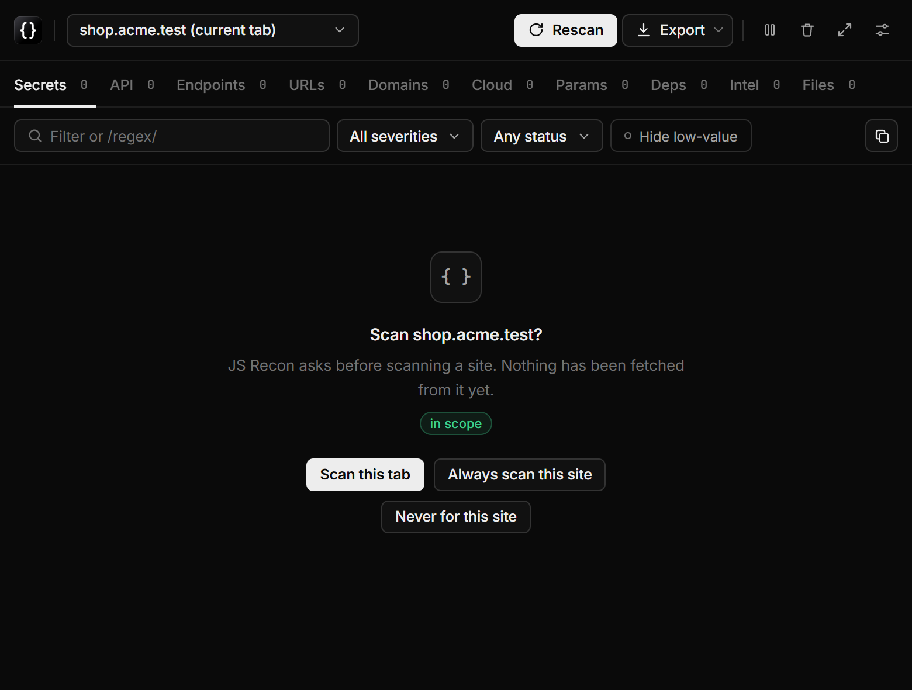<br/><sub><b>Ask before scanning</b> (the default): nothing is fetched from a site until you OK it, and the chip says whether the program scope covers it</sub></td>
  </tr>
</table>

<p align="center">
  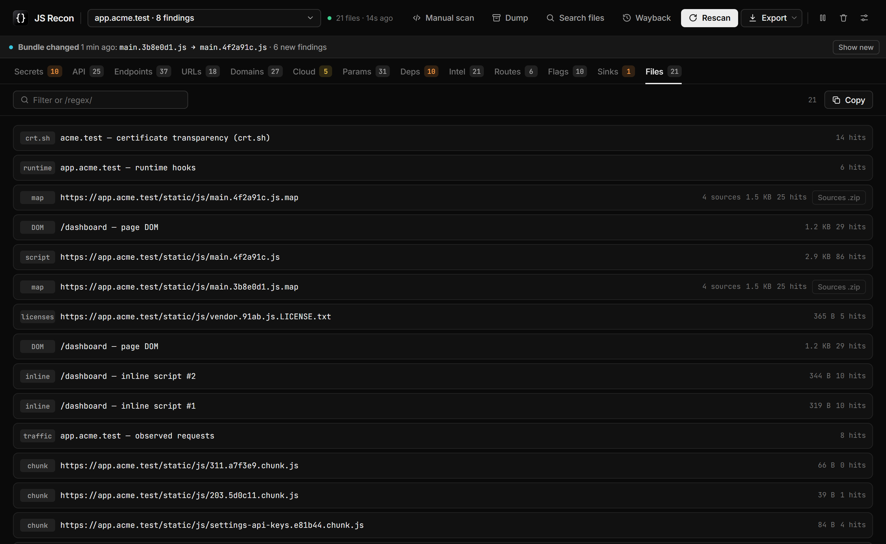
  <br/><sub><b>Files</b>: scripts, never-loaded lazy chunks, iframes, source maps (rebuilt sources as a ZIP), license files, headers, observed traffic, runtime hooks, certificate-transparency and archived files</sub>
</p>

<table>
  <tr>
    <td width="50%">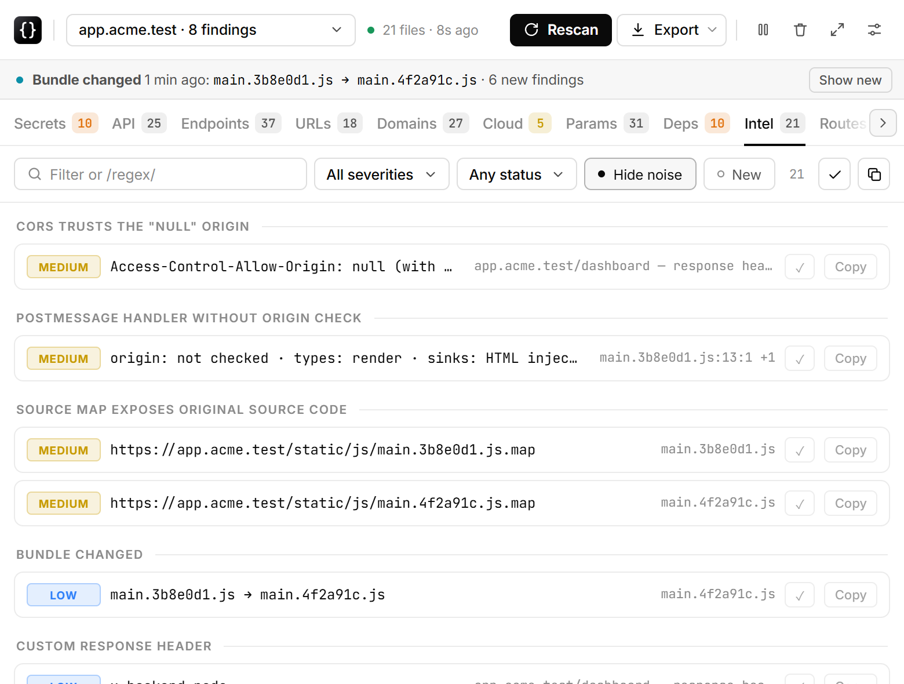<br/><sub><b>Intel</b>: CORS and CSP weaknesses, postMessage handlers, exposed source maps, redeploys, server banners. Shown in the light theme, which follows the system setting</sub></td>
    <td width="50%">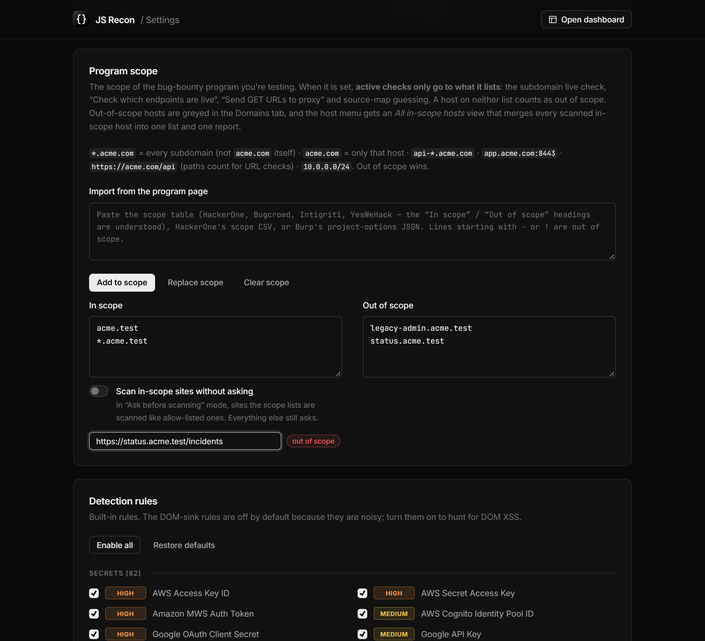<br/><sub><b>Program scope</b>: paste the scope from the program page; active checks only go to what it lists, and a tester says where any host or URL falls</sub></td>
  </tr>
</table>

> Black-and-white chrome, colour reserved for meaning: severity, HTTP method, tags. Inter and JetBrains Mono are bundled, so the extension makes no font requests.

---

## 🏗️ How it works

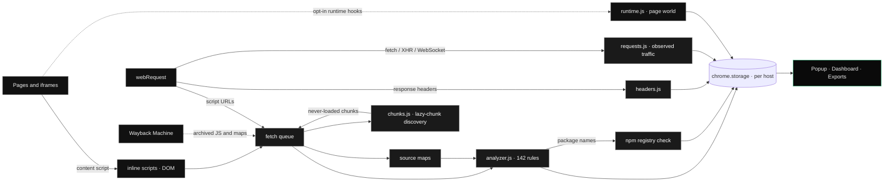

- **Capture.** `webRequest` reports every script the page loads (including chunks loaded later), the target's response headers and the fetch / XHR / WebSocket calls the page makes. A content script runs in the page **and its iframes**, collecting inline scripts and, optionally, the rendered DOM. Findings from iframes are filed under the top page's host.
- **Fetch.** A queue re-reads each script with the page's cookies (`force-cache`, so normally from the browser cache) and de-duplicates by SHA-1.
- **Analyse.** `src/analyzer.js` runs the rule set (pure JavaScript, no `chrome.*`, unit-tested in Node). Source maps are followed, including inline `data:` maps. `src/chunks.js` evaluates the bundler's chunk-filename expression for every chunk id. `src/headers.js` reads response headers, `src/requests.js` the requests the page sends.
- **Store and show.** Findings are merged per host into `chrome.storage.local` with every source location and a context snippet. The popup, the full-page dashboard and the exports read from there.

<details>
<summary><b>Runtime hooks (opt-in) in detail</b></summary>

When enabled, `src/runtime.js` is registered with `chrome.scripting.registerContentScripts({ world: "MAIN", runAt: "document_start" })` for in-scope hosts only, and unregistered when you switch it off. It wraps a few native functions in Proxies (same name and `toString`, never throws into the page) and records **names, never values**:

| Hook | Recorded |
|---|---|
| `URLSearchParams.get / getAll / has` | query parameter names the code reads, even when the name is built at runtime |
| `Storage.getItem / setItem / removeItem` | localStorage / sessionStorage keys |
| `document.cookie = …` | names of cookies the code writes |
| `Element.getAttribute / hasAttribute("data-…")` | `data-*` attributes |
| `fetch` / `XMLHttpRequest` bodies | top-level JSON / form field names per endpoint (mass-assignment candidates) |
| `addEventListener("message")` / `onmessage` | the handler's source, analysed for origin check, message types and sinks |

The data reaches the extension through a DOM event, so a page could forge it: runtime findings are tagged *runtime*.

</details>

<details>
<summary><b>Lazy-chunk discovery in detail</b></summary>

| Bundler | What is read | Example |
|---|---|---|
| webpack 4 / 5 (CRA, Vue CLI, Angular, Next.js …) | The chunk-filename function, evaluated for every id in its maps, resolved against the public path | `n.u = e => "static/js/" + ({35:"admin"}[e] \|\| e) + "." + {35:"1f2e3d4c"}[e] + ".chunk.js"` |
| Next.js | `static/chunks/…` paths in the runtime, build manifest and app-router flight data; **routes** from `__BUILD_MANIFEST` | `"/admin/users/[id]": ["static/chunks/pages/admin/users/[id]-22bb.js"]` |
| Vite | The preload dependency list | `__vite__mapDeps … m.f = ["assets/Admin-1a2b3c.js", …]` |
| ES modules (esbuild, Rollup, Angular 17+) | Literal dynamic imports | ``import(`./chunk-hAxdiaEY.js`)`` |

Tested against live apps: github.com (1,669 chunks from one runtime), nextjs.org (Turbopack, 56 chunks from the HTML), angular.dev (218 chunks). Up to 400 chunks per host are fetched (configurable), names matching *admin*, *internal*, *billing*, *settings* … first. The full list is in the exports.

</details>

---

## 🚀 Install

1. Clone the repo:
   ```bash
   git clone https://github.com/0xnookie/js-recon.git
   ```
2. Open `chrome://extensions` (or `edge://extensions`) and enable **Developer mode**.
3. Click **Load unpacked** and select the `js-recon` folder.
4. Pin the extension and browse your target. The toolbar badge counts critical findings plus high and medium secrets.

No build step and no runtime dependencies. Chrome / Edge 116+; the styled drop-downs need 135+ and fall back to native ones before that.

**Firefox 128+:** download `js-recon-firefox-<version>.zip` from the [releases](https://github.com/0xnookie/js-recon/releases) (or run `node tools/build-firefox.mjs`, which writes `dist/firefox/`), open `about:debugging#/runtime/this-firefox` → **Load Temporary Add-on…** and pick the ZIP or `dist/firefox/manifest.json`. Same code, a Firefox manifest. Release Firefox keeps an unsigned add-on until it restarts; Developer Edition / Nightly can keep it with `xpinstall.signatures.required` set to `false`.

**Command line (Node 20+):**
```bash
npm install -g github:0xnookie/js-recon      # or run it from the clone: node cli/js-recon.mjs
js-recon https://app.example.com/                       # a page: its scripts, source maps, lazy chunks
js-recon -l urls.txt --json report.json --sarif out.sarif
cat urls.txt | js-recon -l - --only secrets,flags --min-severity medium
js-recon ./jsrecon-dump/ --host app.example.com         # local files, e.g. the extension's Dump ZIP
js-recon https://app.example.com/ -H "Cookie: session=…" --scope scope.csv --fail-on high
```
The same analysis as the extension (rules, source maps, lazy chunks, libraries, flags, passwords) without the browser: what a page loads is fetched once. `-H` headers (a session cookie, a token, the program's research header) go only to the targets' own sites, never to scripts, source maps or files hosted elsewhere. `--scope` takes the program scope in any format the Settings page imports; excluded hosts are never requested, not even through a redirect. `--fail-on high` makes it a CI gate. `js-recon --help` lists every option.

---

## 🕹️ Usage

- **Popup:** Secrets · API · Endpoints · URLs · Domains · Cloud · Params · Deps · Intel · Files, plus Routes, Flags and Sinks when they have something. Filter with text or `/regex/`, narrow by severity or triage status, hide tentative secrets or noise, show only *interesting* items. Click a row for every source location with highlighted context, decoded JWT claims, entropy, npm status and library advisories, and to mark it reviewed / reported / false positive.
- **Dashboard** (⤢ in the popup): the same in a full tab, plus a host switcher (with *All in-scope hosts* once a program scope is set), the **Manual scan** panel (JS / `.map` URLs or pasted code), the **Dump** panel, the **Search file contents** panel (grep the chunks for a string or `/regex/`) and **Wayback** (historical JS of the current host).
- **Rescan** re-fetches and re-scans every file of the current host and re-collects the page and its iframes.
- **Export:**

  | Export | Format |
  |---|---|
  | JSON report | one host, all in-scope hosts merged, or all hosts: every finding with its sources, the discovered chunk list, host checks and triage status |
  | Text report | grouped by tab |
  | **Markdown report** | `.md` grouped by tab, ready to paste into a ticket, PR or wiki |
  | **SARIF 2.1.0** | `.sarif` of the secret, sink, intel, cloud and dependency findings with their source file + line, for CI code-scanning (GitHub / GitLab security tabs, DefectDojo, ZAP) |
  | Endpoints + API as URLs | absolute URLs for ffuf, httpx, nuclei |
  | API endpoints | `METHOD URL` per line |
  | **Wordlists** | ZIP: `params.txt`, `query-params.txt`, `body-fields.txt`, `form-fields.txt`, `data-attributes.txt`, `headers.txt`, `cookies.txt`, `storage-keys.txt`, `paths.txt`, `path-segments.txt`, `urls.txt`, `subdomains.txt`, `live-hosts.txt`, `high-value-hosts.txt` and a README with ffuf / Arjun / x8 / Param Miner / nuclei commands |
  | **GraphQL schema + operations** | `.graphql`: the inferred schema sketch, then every operation and fragment |
  | **OpenAPI 3** | `.json` for Burp (Professional API scan, or the OpenAPI Parser extension in Community), Caido (ReDocs plugin), ZAP, Insomnia |
  | **Postman collection** | v2.1 `.json` for Postman, Insomnia and Caido (ReDocs plugin); `{{baseUrl}}`, `:id` path variables, JSON bodies, a GraphQL folder |
  | Send GET URLs to proxy | not a file: requests each concrete same-site GET URL once (active, see below) |
  | Search file contents | not a file: greps every scanned JS file and rebuilt source of the host for a string or `/regex/` |
  | Dump static files | ZIP of JS files, `.map` files and rebuilt source trees |
  | Historical JS (Wayback) | not a file: fetches and scans archived JS / maps of the host |

- **Custom rules** (Settings): one per line as `Name | critical/high/medium/low/info | /regex/flags`; group 1 becomes the value.

---

## ⚙️ Settings & network activity

Everything below runs locally. This is all the traffic the extension itself creates:

| Setting | Default | Traffic |
|---|---|---|
| Passive scanning, inline scripts, page DOM, response headers, observed requests | on, for sites you approve | none beyond re-reading scripts the page loaded (normally from the cache) |
| Follow source maps | on | requests `.map` files the scripts point to |
| **Fetch lazy-loaded chunks** | on, max 400 / host | requests chunk files listed by the bundler runtime |
| Dependency-confusion check | on | sends package **names** to `registry.npmjs.org` (cached 3 days) |
| Known-vulnerable libraries | on | none: advisories are bundled. Reads the `.LICENSE.txt` a webpack bundle points to (a static file, like a source map) |
| Runtime hooks | **off** | none; injects `src/runtime.js` into in-scope pages |
| Wayback Machine for new hosts | **off** (button: on demand) | sends the **host name** to `web.archive.org` and fetches archived files from there, never from the target |
| Certificate transparency (Domains → *Find more*) | manual, one click | sends the **registrable domain** to `crt.sh`; nothing goes to the target or the hosts it names |
| Subdomain live check (Domains → *Check live*) | manual, two clicks | one `GET /` per subdomain of the same registrable domain (HTTPS, then HTTP), max 500, **no cookies**, the host's own redirects followed; plus one made-up subdomain to detect wildcard DNS. Deny-listed hosts are skipped |
| Guess source-map locations | **off** | requests `file.js.map`, then `file.map` |
| Crawl referenced JS | **off** | requests same-site `.js` URLs found in code |
| Send GET URLs to proxy | manual, two clicks (Export menu) | one GET per concrete same-site URL, max 500, with your cookies; skips URLs with placeholders and anything that sounds state-changing (logout, delete, reset, revoke …); redirects are not followed |

**Program scope:** once set (Settings → *Program scope*), every active request above — the subdomain live check, endpoint liveness, *Send GET URLs to proxy*, source-map guessing — only goes to hosts and URLs it lists; anything excluded or unlisted is skipped and counted. Without one, they stay on the target's own registrable domain as before.

**Scope:** by default JS Recon **asks before scanning a site**. Nothing is fetched, observed or hooked until you OK it: a **?** on the toolbar icon means the tab is waiting, and the popup offers *Scan this tab* (one-off, while the tab stays on that host), *Always scan this site* (adds it to the allow-list) or *Never* (adds it to the deny-list). Other modes: only the active tab, every open tab, or only the allow-list; a deny-list is never scanned in any mode. Analytics / ad / consent scripts are ignored (editable), and scripts can optionally be restricted to first-party only. Iframes follow the same filters as scripts. Every rule can be switched off individually.

---

## 🧪 Tests

```bash
node test/run-tests.mjs        # rules, inputs, headers, lazy chunks, postMessage, routes, DOM-XSS taint, offline enrichment
                               # (AWS/GCP/Firebase + JWT expiry), provider-token rules, observed requests, GraphQL + schema,
                               # OpenAPI / Postman / SARIF, Wayback order, crt.sh parsing, takeover / product fingerprints,
                               # high-value rating, program-scope import + matching, library versions + advisories,
                               # program-view merge, feature flags (SDK calls, bootstrap state, keys), passwords (pairs,
                               # checks, variables, false-positive guards), notes, Firefox manifest, CLI engine, ZIP, 6 MB perf
node test/sw-harness.mjs       # service worker end to end with mocked chrome.*, fetch, npm and archive.org: iframes, chunks,
                               # headers, observed traffic, runtime hooks, Wayback, crt.sh, subdomain live check + wildcard DNS,
                               # change alerts, send to proxy, endpoint liveness, dumper, vulnerable libraries + .LICENSE.txt,
                               # triage (badge, rescans), program scope on every active check, ask-first + scope,
                               # feature flags merged across files, notes
node test/fp-sweep.mjs <dir>   # scan a directory of real JS and list secret hits (false-positive check)
```

---

## 🗂️ Project layout

```
manifest.json
src/background.js   service worker: capture, fetch queue, source maps, lazy chunks, headers, traffic, runtime, Wayback, npm, storage
src/analyzer.js     pure scanning engine (no chrome.*, testable in Node)
src/rules.js        rules, link / API / input classification, postMessage analysis, dependency extraction, custom rules
src/request.js      request shape of API calls: URL variables, body fields / sample payload, IDOR candidates
src/chunks.js       lazy-chunk discovery (webpack chunk-map evaluator, Next.js, Vite, ESM)
src/routes.js       client-side route-map extraction (React Router, Vue Router, Angular)
src/taint.js        DOM-XSS taint flows (source → sink in one expression)
src/enrich.js       offline secret enrichment (AWS key → account number, GCP/Firebase → project, JWT expiry, example / demo triage)
src/headers.js      response-header analysis (CORS, CSP, cookies, banners, custom headers)
src/requests.js     observed requests (path normalisation, parameter / header names), script families, Wayback order
src/graphql.js      GraphQL document extraction, parser and schema sketch
src/exporters.js    OpenAPI 3 and Postman v2.1 builders, "send to proxy" URL filter
src/hosts.js        subdomains: crt.sh parsing, live-check fingerprints (title, product, takeover, wildcard), high-value rating
src/scope.js        program scope: import (scope text, HackerOne CSV, Burp JSON) and host / URL matching
src/libs.js         library versions (banners, version strings, URLs, .LICENSE.txt) → advisories
src/flags.js        feature flags: SDK call sites, bootstrap / config states, provider attribution
src/passwords.js    passwords the generic rule misses: credential pairs, client-side checks, variables, btoa
src/vulndb.js       advisory data generated from retire.js (tools/update-vulndb.mjs), Apache-2.0, see vulndb-LICENSE.md
src/runtime.js      opt-in hooks that run in the page's own world
src/sourcemap.js    source-map parsing shared by worker and UI
src/zip.js          small ZIP writer (deflate via CompressionStream)
src/content.js      collects script URLs, inline scripts and DOM from pages and iframes
ui/                 popup / dashboard / settings, dump.js (source reconstruction + dumper), search.js (content grep),
                    program.js (all in-scope hosts merged into one view)
icons/  fonts/      toolbar icons and logo; Inter and JetBrains Mono (SIL OFL)
assets/             README banner and screenshots
cli/                command line: js-recon.mjs (options, output), scan.mjs (fetch + analysis engine)
tools/              update-vulndb.mjs (retire.js advisories), build-firefox.mjs (Firefox manifest + ZIP)
test/               Node tests
.github/workflows/  CI (tests + checks) and tagged-release packaging
```

---

## 🛡️ Safety & Authorization

JS Recon is for **authorized** security testing only: pentest engagements, bug-bounty programs within their scope, your own systems, CTFs and research.

- ✅ Passive by default; active options (source-map guessing, crawling) are off and labelled
- ✅ Runtime hooks and automatic Wayback lookups are opt-in; hooks only run on in-scope hosts
- ✅ "Send GET URLs to proxy" needs two clicks, stays on the target's own site and skips anything that sounds state-changing
- ✅ The subdomain live check needs two clicks, only requests `/` of the target's own subdomains, sends no cookies and never touches deny-listed hosts
- ✅ Only names are recorded from real traffic and at runtime, never values (Authorization: scheme only)
- ✅ Scope allow-list / deny-list and per-rule switches
- ✅ With a program scope set, active checks never contact a host or URL it doesn't list
- ✅ Findings stay in your browser; nothing is uploaded
- ✅ The dependency-confusion check only *reads* the npm registry; nothing is ever published
- ✅ The CLI only requests what a target page loads: the page, its scripts, source maps, lazy chunks and `.LICENSE.txt` files. It never contacts subdomains, crt.sh, npm or the Wayback Machine
- ✅ The CLI's `-H` headers (cookies, tokens) only go to the targets' own sites, also across redirects, never to scripts, source maps or files hosted elsewhere
- ✅ With `--scope`, the CLI skips targets outside the scope and never requests a host or URL the scope excludes, redirects included
- ✅ CLI results go to your terminal and the files you name (`--json`, `--sarif`); nothing is uploaded
- ❌ Don't point it at systems you aren't authorized to test
- ❌ Results are leads, not verdicts: confirm secrets, dependency-confusion candidates, CSP / CORS findings and takeover signatures (`dig CNAME host`) before reporting
- ❌ Set the program scope (Settings → *Program scope*) before running active checks; without it they cover the target's whole registrable domain, and a single-host program doesn't allow that
- ❌ An outdated library is a lead, not a finding: show that the app reaches the vulnerable code before reporting

**Dependency-confusion results need confirming.** A name missing from npm only matters if some build resolves it from the public registry. The scope check uses `/-/org/<scope>/package` and `/-/user/<scope>/package`; if neither answers clearly the result is *scope status unknown*, so check `npmjs.com/org/<scope>` by hand.

---

## 📜 License

MIT, see [`LICENSE`](LICENSE). Bundled fonts: Inter and JetBrains Mono under the SIL Open Font License (`fonts/`). Bundled advisory data (`src/vulndb.js`) is generated from the [retire.js](https://github.com/RetireJS/retire.js) repository under the Apache License 2.0 (`src/vulndb-LICENSE.md`); refresh it with `node tools/update-vulndb.mjs`.
Use JS Recon only against systems you are explicitly authorized to test.
